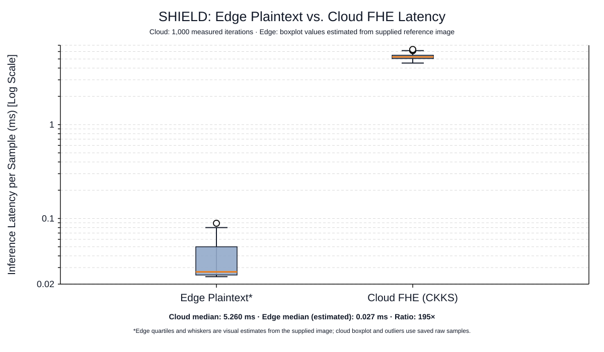
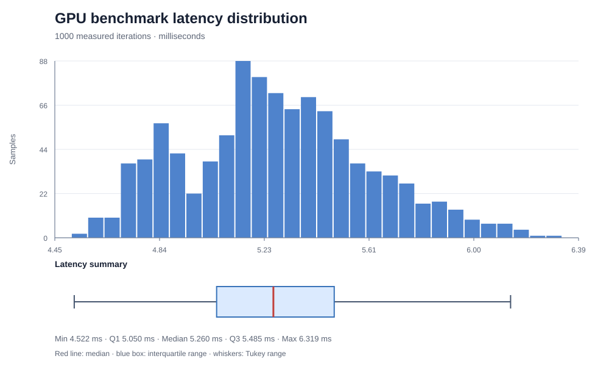
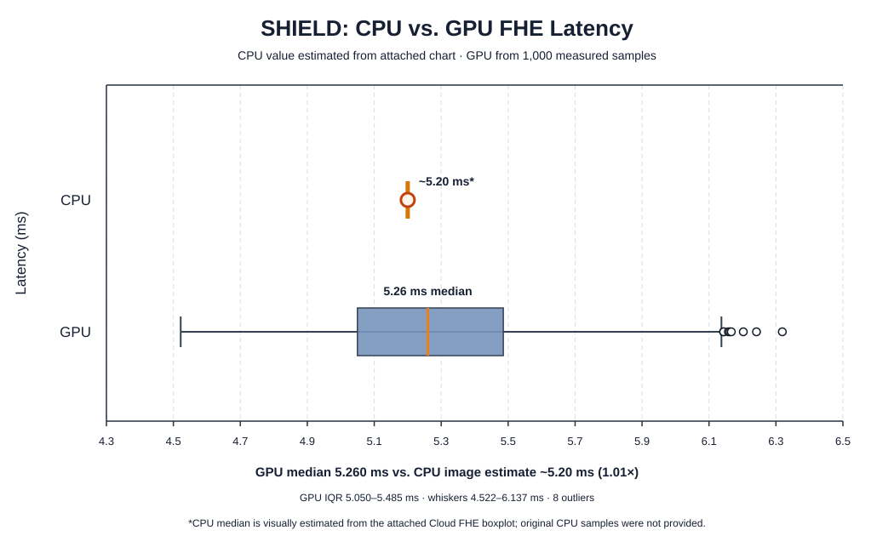
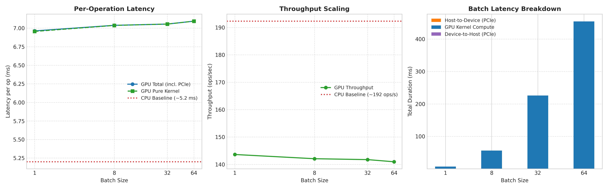
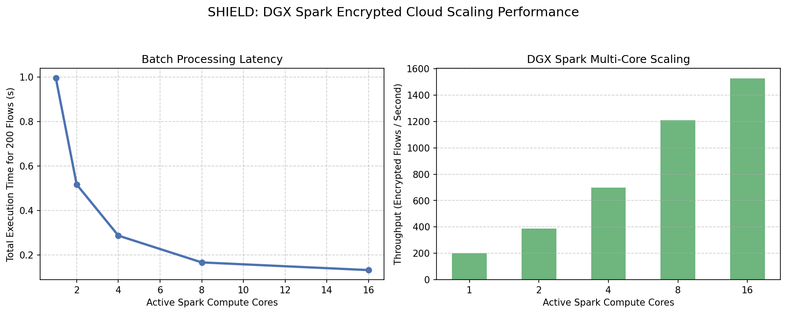
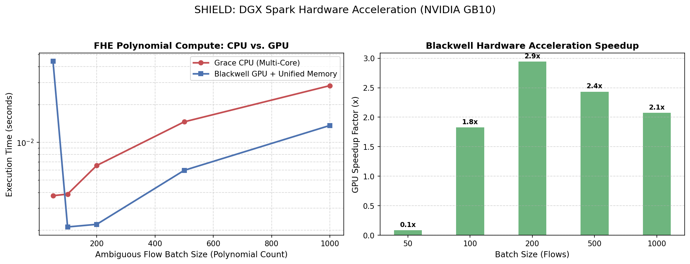

# SHIELD: Privacy-Preserving Network-Flow Analysis

SHIELD is a feasibility prototype for a hybrid edge/cloud intrusion-detection
workflow. Its goal is to keep routine decisions local and send only ambiguous
network-flow features to a remote evaluator as encrypted data. The project
combines a synthetic classification demo, CKKS/OpenFHE experiments, and
exploratory CPU/GPU and multi-process benchmarks aimed at NVIDIA DGX Spark.

> **Status:** research prototype, not a production intrusion-detection system.
> The repository contains useful end-to-end and hardware-exploration pieces,
> but does not yet demonstrate a production-ready encrypted inference service or
> a verified FHE implementation running on the Blackwell GPU. See
> [What the results do and do not show](#what-the-results-do-and-do-not-show).

## Project goal and workflow

The intended SHIELD flow is:

1. A network sensor extracts continuous features from each traffic flow.
2. A local edge classifier scores each flow. High-confidence decisions are
   handled locally.
3. A low-confidence flow is encrypted with CKKS and sent to a cloud compute
   tier. The evaluator computes on ciphertext without needing the edge's
   decryption key.
4. The encrypted result returns to the edge for decryption and classification.

The demo in [`shield_hybrid_demo.py`](./shield_hybrid_demo.py) uses 1,000
synthetic examples with 10 features, trains a logistic-regression model, and
uses a confidence threshold of 0.75 to choose between local inference and a
CKKS encrypted dot-product path. It reports accuracy, F1, routing counts,
latencies, and CKKS numerical differences. This is a feasibility simulation
using generated data, not an evaluation on real network traffic.

## How NVIDIA DGX Spark architecture helps this project

DGX Spark is relevant because the planned encrypted-compute tier benefits from
having an Arm Grace CPU and a Blackwell GPU in one system, with the
NVLink-C2C-connected, unified-memory architecture intended to make CPU/GPU data
sharing more direct. In the SHIELD design, those pieces can help in different
ways:

- **Grace CPU (Arm64):** runs the host-side application, preprocessing,
  orchestration, and CPU-capable FHE libraries. The multi-core experiment
  explores whether independent encrypted-flow requests can be spread across
  CPU workers.
- **Blackwell GPU and CUDA:** offer substantial parallel compute for suitable
  batched operations. FHE arithmetic contains large polynomial operations, so
  accelerating those kernels could improve throughput for batches of
  ambiguous flows—if the FHE library and kernels are actually implemented for
  and dispatched to the GPU.
- **NVLink-C2C and unified memory:** are intended to reduce friction when CPU
  and GPU code share data, and can help avoid unnecessary copies in a
  properly integrated implementation. This matters for FHE because ciphertexts
  and intermediate polynomial values can be large. It does not, by itself,
  make a CPU library GPU-accelerated or guarantee zero-copy transfers.
- **Single developer system:** lets the project prototype edge/cloud-style
  execution, CPU scaling, CUDA kernels, and memory-transfer strategies on one
  compact platform before deciding how to deploy the compute tier.

The current experiments are early steps toward this architecture, not proof
that the full encrypted inference pipeline runs on Blackwell. In particular,
[`fhe_blackwell_unified_benchmark.py`](./fhe_blackwell_unified_benchmark.py)
compares floating-point PyTorch FFT convolution on CPU and GPU; it does not
perform CKKS modular polynomial arithmetic. Its `.to(device)` calls explicitly
copy host tensors to CUDA memory, so the script does not establish a
zero-copy/unified-memory result. Likewise,
[`bench_latency_gpu.py`](./bench_latency_gpu.py) times OpenFHE `EvalMult`
calls, which are not dispatched to CUDA by this code; its transfer timing
sections are placeholders. These experiments are useful scaffolding for
benchmark development, but their charts should not be read as verified FHE GPU
speedups.

## Repository contents

| File | Purpose |
| --- | --- |
| [`shield_hybrid_demo.py`](./shield_hybrid_demo.py) | Synthetic-data edge/cloud routing demo using scikit-learn and Pyfhel CKKS. |
| [`test_openfhe_client.py`](./test_openfhe_client.py) | Small OpenFHE CKKS encrypt, multiply, decrypt, and verification smoke test. |
| [`spark_scale_benchmark.py`](./spark_scale_benchmark.py) | Pyfhel CKKS workload split over process-worker counts; generates the Spark scaling chart. |
| [`fhe_blackwell_unified_benchmark.py`](./fhe_blackwell_unified_benchmark.py) | PyTorch CPU/GPU floating-point FFT proxy benchmark; generates the Blackwell acceleration chart. |
| [`bench_latency_gpu.py`](./bench_latency_gpu.py) | OpenFHE batch timing experiment and JSON output; CUDA transfer sections are placeholders. |
| [`plot_latency.py`](./plot_latency.py) | Plotting script for the batch timing JSON. |
| [`Dockerfile`](./Dockerfile) | CUDA-based development image that builds OpenFHE and its Python bindings and attempts to fetch a GPU-backend repository. |
| [`visualizations/`](./visualizations) | Saved charts and benchmark JSON snapshots. |

The scripts are independent experiments rather than one integrated executable
pipeline. They use different libraries, schemes, and workloads; their timings
are not directly interchangeable.

## What the DGX Spark container contains

The checked-in [`Dockerfile`](./Dockerfile) defines a **development container**,
not a ready-to-run SHIELD application image:

- **Base:** NVIDIA CUDA 12.8 development image on Ubuntu 22.04. CUDA development
  tools come from the base image; NVIDIA GPU access at runtime still depends on
  a correctly configured host driver and NVIDIA Container Toolkit.
- **Build tools and system packages:** `build-essential`, CMake, Git, wget,
  OpenMP development libraries, Python 3, pip, Python headers, and pybind11
  headers.
- **OpenFHE native library:** source tag `v1.5.1`, built in Release mode as
  static libraries with OpenMP enabled; OpenFHE benchmarks and unit tests are
  disabled for the container build.
- **OpenFHE Python bindings:** cloned and compiled against the installed
  OpenFHE library. The Dockerfile does not pin a binding commit/tag.
- **GPU-backend source attempt:** it attempts to clone
  `FreeMark/openfhe-gpu-backend` to `/workspace/openfhe-gpu-backend`. The
  command is allowed to fail (`|| true`); the backend is not built, linked, or
  activated by this Dockerfile.
- **Startup behavior:** sets `/workspace` as the working directory and starts
  an interactive Bash shell. It does not copy the project scripts or install
  their Python dependencies into the image.

In particular, the Dockerfile does not install PyTorch, Pyfhel, NumPy,
scikit-learn, or Matplotlib via pip. Do not assume a script is runnable until
its imports and CUDA requirements have been checked inside the built image.
Also, mounting the host project over `/workspace` hides the backend clone
stored there in the image; mount the project at another path (such as
`/work/shield`) if you need to inspect that clone.

### Container workflow for efficient experiments

Build the image once, then reuse it for multiple experiments rather than
rebuilding OpenFHE for every run:

```bash
docker build -t shield-spark .
docker run --rm -it --gpus all \
  -v "$PWD:/work/shield" -w /work/shield \
  shield-spark
```

The `--gpus all` option requires GPU container support on the host. Inside the
container, first verify device visibility (for example, `nvidia-smi` and a
small PyTorch `torch.cuda.is_available()` check), then verify the OpenFHE
Python import and each script's other dependencies. If an import is missing,
install it in a controlled project environment or deliberately add and pin it
in the image; the current Dockerfile does not supply a reproducible Python
dependency set.

For useful Spark measurements, keep the development and measurement stages
distinct:

1. **Validate the actual execution device.** A CUDA-enabled base image alone
   does not move OpenFHE operations to the GPU. Confirm that the selected FHE
   backend supports the operation and that profiling shows GPU kernels being
   launched.
2. **Measure equivalent workloads.** Compare the same scheme, parameters,
   ciphertext sizes, and operations on CPU and GPU. Record encryption,
   evaluation, decryption, and transfer costs separately; do not compare the
   floating-point FFT proxy with real FHE results.
3. **Use batches where appropriate.** GPU parallelism is most useful when
   there is enough independent work to amortize launch and transfer overhead.
   Retain single-item latency measurements as well as batch throughput.
4. **Tune CPU parallelism without oversubscription.** OpenFHE is built with
   OpenMP, while the scaling script also creates multiple processes. Set and
   record OpenMP/thread counts alongside process counts so each worker does
   not independently attempt to use every core.
5. **Make results reproducible.** Pin the OpenFHE binding/backend revisions
   and Python dependencies; save raw timing samples, exact commands, device
   identity, and cryptographic parameters with each chart.

These steps let the container's CUDA toolchain and OpenMP-enabled OpenFHE
support a faster experimental loop, while keeping GPU acceleration claims tied
to verified FHE execution rather than image contents alone.

## Visualizations

### End-to-end latency comparison



**Description:** Compares local plaintext inference against cloud CKKS latency
on a logarithmic scale. The SVG states that cloud latency is based on 1,000
measured iterations, while the edge boxplot values were estimated from a
reference image. Its displayed 195× ratio is therefore illustrative, not a
reproducible measured speedup. The original samples and reference image are not
included here.

### GPU latency distribution



**Description:** Shows the distribution and summary of 1,000 latency samples:
5.260 ms median, 5.050–5.485 ms interquartile range, and 4.522–6.319 ms
minimum-to-maximum. This image does not identify a checked-in raw-sample file
or a reproducible command that generated these exact values, so treat the
statistics as a saved benchmark snapshot.

### CPU/GPU latency comparison



**Description:** Presents the same 5.260 ms GPU median against an approximately
5.20 ms CPU value estimated from a chart. The SVG's stated 1.01× ratio is not a
validated hardware comparison: the repository's OpenFHE timing script runs
`EvalMult` through the OpenFHE API and does not establish GPU execution.

### Batched FHE-operation timing summary



**Description:** Three panels compare per-operation latency, throughput, and
the reported transfer/kernel timing as batch size increases from 1 to 64.
The plotted values correspond to the saved JSON snapshot in
[`latency_gpu_results_serial.json`](./visualizations/latency_gpu_results_serial.json):
about 6.96–7.09 ms per operation and 141–144 operations per second. The CPU
reference is hard-coded at 5.20 ms (about 192 operations per second). The chart
is an exploratory report, not evidence of GPU-accelerated OpenFHE: the
benchmark code's transfer sections are placeholders and its FHE evaluation is
not shown to use CUDA. The other saved snapshot,
[`latency_gpu_results.json`](./visualizations/latency_gpu_results.json),
reports a different run (about 8.86–9.64 ms per operation), so results should
not be combined without reconciling the run configurations and provenance.

### DGX Spark multi-core scaling



**Description:** Shows elapsed time and throughput for a synthetic batch of
200 flows as the process-worker allocation rises from 1 to 16. The plot
illustrates the experiment's intended CPU parallelism investigation; its
values are not checked into a raw results file, and they are specific to the
system and run configuration. They are not a GPU benchmark.

### Blackwell CPU/GPU compute proxy


**Description:** Compares CPU and GPU timings for batched float32 FFT,
pointwise multiplication, and inverse FFT over ring-dimension-sized vectors.
The chart labels this as FHE polynomial compute and reports GPU speedups for
larger batches, but the code implements a floating-point convolution proxy,
not CKKS/FHE ciphertext arithmetic. Host-to-device copies are part of the GPU
timing. The graph therefore shows a preliminary CUDA workload experiment, not
measured FHE acceleration or a demonstrated zero-copy path.

The same chart is also saved in the visualizations folder:



**Description:** This is a duplicate copy of the chart above, retained at the
path used by the other saved visualizations. It represents the same FFT proxy
experiment and has the same limitations.

## FHE and implementation notes

- The hybrid demo and scaling experiment use Pyfhel with CKKS parameters
  including polynomial degree `n=8192`.
- The OpenFHE smoke test uses CKKS packed real values and checks an encrypted
  multiplication/decryption round-trip.
- The OpenFHE timing experiment configures BFV, while other experiments use
  CKKS. Scheme parameters and workloads differ, so results should be compared
  only after standardizing the workload and setup.
- CKKS is approximate arithmetic. The demo compares decrypted scores against a
  plaintext score and reports numerical differences; tolerances and security
  parameters must be selected and documented for any real deployment.
- The Dockerfile starts from a CUDA 12.8 development image and builds OpenFHE
  1.5.1 plus its Python bindings. It also attempts to clone an FHE GPU-backend
  repository, but this alone does not build, configure, or route OpenFHE
  operations through that backend.
- The demo generates synthetic classification data at runtime. No real
  network-flow dataset, deployment API, authentication, key-management
  service, or production monitoring is included.

## Running the experiments

The scripts require their Python dependencies and compatible system libraries;
the project does not currently include a Python dependency lockfile or a
single environment setup command. The container recipe is provided as a
development starting point, but it may require adaptation to the target
machine and FHE backend.

Examples:

```bash
python3 shield_hybrid_demo.py
python3 test_openfhe_client.py
python3 spark_scale_benchmark.py
python3 fhe_blackwell_unified_benchmark.py
python3 bench_latency_gpu.py
```

The benchmark scripts generate some images and JSON files in their configured
output locations. They may overwrite saved snapshots. To regenerate
`fhe_benchmark_summary.png`, the plotting script expects a compatible
`latency_gpu_results.json` in its current working directory; its source should
be checked before relying on it, as the saved plot and JSON files have not all
been shown to come from the same run.

## What the results do and do not show

**Demonstrated in code:** a synthetic edge/cloud routing prototype, CKKS
encrypt/evaluate/decrypt examples, a CPU process-scaling experiment, and
exploratory PyTorch CUDA and OpenFHE timing scripts.

**Not established by the checked-in experiments:** detection quality on
real-world traffic, end-to-end network/serialization costs, production
security, a validated speedup for real FHE operations on Blackwell, true
zero-copy transfers, or comparable and reproducible CPU/GPU measurements.

The most important next benchmark step is to run the *same real FHE operation*
with explicit CPU and GPU implementations, verify the result against a
plaintext/reference computation, warm up both paths, measure transfers and
kernel execution separately, and save raw samples with the exact hardware,
software, and cryptographic parameters.
